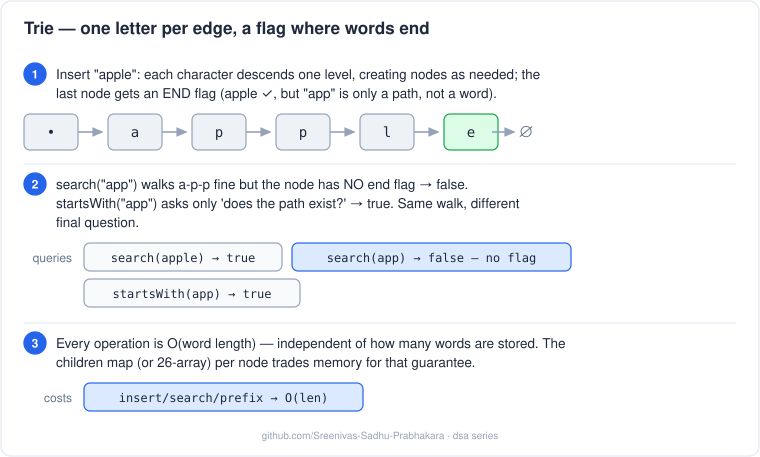

# Implement Trie (Prefix Tree)

> Striver SDE Sheet 185 · Day 27 Trie — one node per shared prefix character; a word-end flag distinguishes "apple" from the mere path "app". Go, stdlib only, tested.

## Problem

A trie with Insert, Search (exact word) and StartsWith (any word with the prefix) — the structure behind autocomplete, spell-checkers and the XOR problems closing the sheet.

## Approach

Each node owns a 26-slot child array (one per letter) and an `isWord` flag. Insert walks the word, materializing missing nodes. Both lookups share one `walk` helper that descends while the path exists; Search additionally demands the flag — the flag is the whole difference between a *word* and a *path*, which the "apple vs app" test pins. Array children give O(1) per character and cache-friendly hops; a map per node trades memory for alphabet flexibility. Every operation costs the key's length — independent of how many words are stored, which is the trie's selling point over hashing when prefixes matter.

**Complexity:** all operations O(len(key)); space O(total characters).

## Visual walkthrough

Read the picture top to bottom — each numbered frame is one moment of the algorithm
running on this repo's test example.

## Run

    go test ./...   # verify
    go run .        # demo

---

One of 191 repos solving Striver's SDE Sheet in Go — stdlib only, one problem per repo, every solution tested. Browse the set: [`dsa-*` repos](https://github.com/Sreenivas-Sadhu-Prabhakara?tab=repositories&q=dsa-&type=source).
